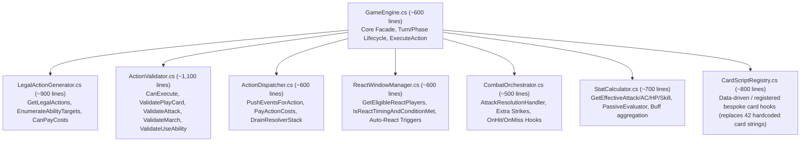
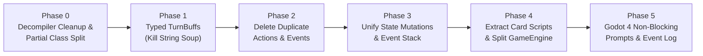

# Warlord-CCG Architecture Audit & Phased Refactoring Plan

> **Audit Scope**: Static and runtime-flow audit of `src/`, `WarlordCli/`, and `tests/WarlordEngine.Tests/`.  
> **Code Modified**: None (audit-only).

---

## Executive Summary

The `Warlord-CCG` engine currently suffers from **two competing architectural models** living side-by-side inside a decompiled 6,431-line God Object (`src/Engine/GameEngine.cs`):

1. **The Event-Stack Model (Original Design)**: `IPlayerAction` $\rightarrow$ `PushEventsForAction` $\rightarrow$ `EventResolver` stack (with priority/react windows) $\rightarrow$ `GameEvent.ApplyToState(state)` $\rightarrow$ `AfterResolve` triggers.
2. **The Direct-Mutation Shortcut Model (Playtest Patch Layer)**: Actions (`PlayCardAction`, `DeployStartingArmyAction`, `DiscardCardAction`, `PassAction`), callbacks (`InstanceOnAttackResolved`), and `IEffect.Evaluate` implementations mutate `GameState`, `PlayerState`, `CardInstance`, and `TurnState` directly—bypassing `EventResolver`, breaking React windows, and causing double-spend and double-buff bugs.

On top of this split brain, the codebase carries **ILSpy/dnSpy decompiler artifacts** (`num2`, `flag4`, `playerState6`, `goto IL_0d35`, `[CompilerGenerated]` record copy constructors), **40+ hardcoded card names** inside core combat/deployment loops, **string-soup turn buffs** stuffed into `TurnState.UsedLimitedAbilityKeysThisTurn` (which silently drops duplicate same-value buffs because it is a `HashSet<string>`), and **blocking CLI callbacks** (`SelectStrikeTarget`) that will deadlock a Godot 4 main-thread loop.

Below is the forensic breakdown of all 5 audited areas followed by a **6-phase, test-safe refactoring plan**.

---

## 1. Duplicate Action & Event Classes (and Why Character Deployment Bypasses `EventResolver`)

### 1.1 Inventory of Duplicate Action & Event Classes

| Concept | Class A | Class B | Generated by `GetLegalActions`? | Verdict |
| :--- | :--- | :--- | :--- | :--- |
| **Deploy Character** | `PlayCardAction` (`src/Actions/PlayCardAction.cs:13`) | `DeployCharacterAction` (`src/Actions/DeployCharacterAction.cs:6`) | **Only `PlayCardAction`** (`GameEngine.cs:1229`) | **Delete `DeployCharacterAction`** after migrating 15 tests in `GameEngineValidationTests.cs`. |
| **Declare Attack** | `AttackAction` (`src/Actions/AttackAction.cs:6`, uses `TargetInstanceId`) | `DeclareAttackAction` (`src/Actions/DeclareAttackAction.cs:6`, uses `DefenderInstanceId`) | **Only `AttackAction`** (`GameEngine.cs:1420`) | **Delete `DeclareAttackAction`** and `ValidateAttack` (`GameEngine.cs:3568`) after migrating 3 assertions in `Task7BPlaytestingFixesTests.cs`. |
| **Pass Priority / Turn** | `PassAction` (`src/Actions/PassAction.cs:6`) | `PassPriorityAction` (`src/Actions/PassPriorityAction.cs:6`) | **Only `PassAction`** (`GameEngine.cs:1110, 1134, 1517`) | **Delete `PassPriorityAction`** after migrating 1 assertion in `Batch3PlaytestFixesTests.cs:461`. |
| **Voluntary Movement** | `MarchAction` (`src/Actions/MarchAction.cs:6`) | `JourneyAction : MarchAction` (`src/Actions/JourneyAction.cs:5`) | Both (`GameEngine.cs:1463, 1480`) | **Keep or replace with enum**: `JourneyAction` is an empty marker subclass distinguishing cross-rank movement from within-rank `MarchAction`. |
| **Movement Event** | `MarchEvent` (`src/Events/MarchEvent.cs:6`) | `CharacterMovedEvent : MarchEvent` (`src/Events/CharacterMovedEvent.cs:5`) | Pushed by `MarchAction` vs `MoveCasterRankEffect` | **Split inheritance**: `CharacterMovedEvent` inherits `MarchEvent` so `EventResolver.RequiresReactWindow` (`EventResolver.cs:52`) opens react windows on effect-driven moves. Make an explicit `MoveType` enum (`March`, `Journey`, `ForcedOrEffect`) on a single `MoveCharacterEvent`. |
| **Action Base Type** | `IPlayerAction` (`src/Actions/IPlayerAction.cs:3`) | `PlayerAction : IPlayerAction` (`src/Actions/PlayerAction.cs:5`) | Mixed | **Consolidate**: `PlayCardAction`, `PassAction`, and `UseAbilityAction` inherit `PlayerAction` (which has virtual `Execute(GameState)`), while all other actions implement `IPlayerAction` directly. Delete `PlayerAction` and use `IPlayerAction` everywhere. |
| **Phase Advancement** | `GameEngine.AdvancePhase` (`GameEngine.cs:3035`) | `TurnState.AdvancePhase` (`src/Engine/TurnState.cs:40`) | N/A | **Delete `TurnState.AdvancePhase()`** (dead code) and remove duplicate enum aliases `TurnPhase.Main = Order` and `TurnPhase.End = EndOfTurn` (`src/TurnPhase.cs:6-16`). |

### 1.2 Forensic Breakdown: `DeployCharacterAction` vs. `PlayCardAction`

- **`DeployCharacterAction` (`src/Actions/DeployCharacterAction.cs:6-20`) is a legacy test/prototype artifact.**
  - It takes a `string DefinitionId` instead of an `int CardInstanceId` from hand!
  - In `GameEngine.PushEventsForAction` (`GameEngine.cs:5142-5159`), executing `DeployCharacterAction` **mints a brand-new `CardInstance` out of thin air**, appends it to `playerState5.Hand`, pushes a `PlayCardEvent`, and then **immediately calls `TriggerCharacterEnterReacts` before `PlayCardEvent` even resolves**:
    ```csharp
    // src/Engine/GameEngine.cs:5148-5158
    CardInstance cardInstance8 = new CardInstance( state.NextInstanceId++, value6, dca.PlayerId );
    playerState5.Hand.Add( cardInstance8 );
    PlayCardEvent evt3 = new PlayCardEvent( dca.PlayerId, cardInstance8.InstanceId, dca.TargetRank, dca.SlotIndex );
    _resolver.PushEvent( evt3 );
    if ( value6.Type == CardType.Character )
    {
        TriggerCharacterEnterReacts( state, dca.PlayerId, cardInstance8, dca.TargetRank );
    }
    ```
  - `GetLegalActions` **never** generates `DeployCharacterAction`. It is only used in 15 early unit tests in `tests/WarlordEngine.Tests/GameEngineValidationTests.cs` (e.g., lines 66, 94, 152, 232, 319) and has a leftover display branch in `WarlordCli/Program.cs:688`.

- **Why `PlayCardAction` bypasses `PlayCardEvent` and `EventResolver` when deploying Characters:**
  - When real gameplay (and AI/CLI) was wired up to play cards from `Hand` using `PlayCardAction`, the author found that `PlayCardEvent.ApplyToState` (`src/Events/PlayCardEvent.cs:15-42`) was incomplete:
    1. `PlayCardEvent.ApplyToState` never updated `item.Rank = TargetRank` (`PlayCardEvent.cs:25-39`).
    2. `PlayCardEvent.ApplyToState` never applied the **Faction Loyalty penalty** (characters whose faction doesn't match the Warlord and lack `Mercenary` must enter play `ReadyState.Stunned`).
    3. `EventResolver.RequiresReactWindow` (`src/Events/EventResolver.cs:47-54`) only returns `true` for `DeclareAttackEvent`, `RollD20Event`, `DealDamageEvent`, `CharacterDefeatedEvent`, `AbilityActivatedEvent`, and `MarchEvent`—it **never included `PlayCardEvent`**!
  - Instead of fixing `PlayCardEvent.ApplyToState` and adding `PlayCardEvent` to `EventResolver.RequiresReactWindow`, the author wrote an inline imperative deployment block directly inside `GameEngine.PushEventsForAction` (`GameEngine.cs:5167-5223`):
    ```csharp
    // src/Engine/GameEngine.cs:5167-5221 (PlayCardAction Character/Token branch)
    if ( value7.Type == CardType.Character || value7.Type == CardType.Token )
    {
        playerState6.Hand.Remove( cardInstance9 );
        int num13 = playCardAction.TargetRank ?? 1;
        ...
        cardInstance9.ReadyState = ( ( !flag6 && !flag7 ) ? ReadyState.Stunned : ReadyState.Ready );
        cardInstance9.Rank = num13;
        ...
        playerState6.Ranks[num13].Insert( index, cardInstance9 );
        TriggerCharacterEnterReacts( state, playCardAction.PlayerId, cardInstance9, num13 );
        return; // <-- Returns without pushing PlayCardEvent to _resolver!
    }
    ```
  - **The Bug This Created**: Because `PlayCardAction` never pushes `PlayCardEvent`, the react-window checks in `GameEngine.IsReactTimingAndConditionMet` (`GameEngine.cs:2017-2030`) and `ValidatePlayCard` (`GameEngine.cs:4462-4479`) that inspect `topPendingEvent is PlayCardEvent` for `ReactTiming.Enter` / `AbilityTrigger.EnterReact` are **completely unreachable during normal gameplay**! Only the 3 hardcoded cards inside `TriggerCharacterEnterReacts` (`"Albrecht Novice"`, `"Frameseer"`, `"Shannon the Daring"`) fire on character entry.

### 1.3 Forensic Breakdown: `AttackAction` vs. `DeclareAttackAction`

- `AttackAction` (`src/Actions/AttackAction.cs:6-23`) uses `TargetInstanceId` (and optional `AdditionalTargetInstanceIds`).
- `DeclareAttackAction` (`src/Actions/DeclareAttackAction.cs:6-23`) uses `DefenderInstanceId` (and optional `AdditionalTargetInstanceIds`).
- Both push the exact same `DeclareAttackEvent` (`GameEngine.cs:5109` and `5123`).
- `GameEngine.cs` maintains **two separate 130-line validation methods**:
  - `ValidateAttack(GameState state, DeclareAttackAction action)` (`GameEngine.cs:3568-3700`)
  - `ValidateAttackAction(GameState state, AttackAction action)` (`GameEngine.cs:3719-3847`)
- **Divergence Bug**: `ValidateAttack` (`GameEngine.cs:3673`) checks ranged distance with `if (rankDistance > 2)`, which allows a `Ranged Strike` against an adjacent rank (`rankDistance == 1`, violating Warlord rules where Ranged Strikes require distance $\ge 2$) and blocks `Longbow` (`maxRange == 3`). Meanwhile, `ValidateAttackAction` (`GameEngine.cs:3819`) correctly calls `BoardGeometry.IsRangedValid(state, action.PlayerId, cardInstance.InstanceId, defenderId, maxRange)`.
- `DeclareAttackAction` is only used in 3 lines in `tests/WarlordEngine.Tests/Task7BPlaytestingFixesTests.cs` (lines 704, 812, 819).

---

## 2. The 6,431-Line `GameEngine.cs` God Object, Decompiler Artifacts, & Hardcoded Cards

### 2.1 Decompiler Artifacts Across the Codebase

The codebase clearly underwent a round-trip through an IL decompiler (ILSpy / dnSpy). Evidence includes:

1. **Synthesized Record Copy Constructors**:
   - Almost every `record` in `src/Actions/`, `src/Events/`, and `src/Effects/` contains explicit `[CompilerGenerated] [SetsRequiredMembers] protected Foo(Foo original)` constructors (e.g., `PlayCardAction.cs:648-660`, `AttackAction.cs:17-22`, `PlayCardEvent.cs:44-52`, `MarchEvent.cs:84-93`). In C#, compiler-synthesized record copy constructors should never be in source files.
2. **Decompiler Local Variable Names & `goto IL_xxxx` Loops**:
   - `GameEngine.cs` is filled with `num`, `num2`..`num15`, `flag`, `flag2`..`flag7`, `list`, `list2`..`list6`, `playerState`, `playerState2`..`playerState6`, `cardInstance`..`cardInstance9`, `value`..`value7`.
   - `AttackResolutionHandler.AfterResolve` (`GameEngine.cs:172-536`) is a 365-line `while (true)` state machine driven by `goto IL_0d35;` (`lines 490, 496, 513, 520, 524`) because the decompiler failed to reconstruct a `foreach` loop containing `yield return` inside `try/finally` blocks.
   - `DrainResolverStack` (`GameEngine.cs:5445-5458`) uses `goto IL_0078;`.
   - `CanExecute` (`GameEngine.cs:946-992`) and `PushEventsForAction` (`GameEngine.cs:4778-5160`) are 12-level-deep nested `if (!(action is Foo))` pyramids instead of a flat `switch (action)`.
   - Dead decompiler tautologies like `if (true) { if (false) { } }` (`GameEngine.cs:4697-4702`).
   - `RulesParser.cs` (`lines 155-159, 567-570`) contains decompiled `CollectionsMarshal.SetCount` + `Span<string>` collection-expression lowering instead of simple `new List<string> { ... }`.
3. **Static Mutable Card Database Globals**:
   - `GameEngine._masterCardDb` and `GameEngine._lastActiveCardDb` (`GameEngine.cs:670-672, 722-741`) are mutated every time a `GameEngine` is constructed, and read by static methods (`GetEffectiveAttack`, `GetEffectiveArmorClass`, `DeathCheckHandler.CheckAndResolveDeaths`). Running concurrent `GameEngine` instances (e.g., parallel MCTS simulations or parallel xUnit tests with different mock card DBs) causes data races on `_lastActiveCardDb`.

### 2.2 Complete Inventory of Hardcoded Card Names in `GameEngine.cs`

There are **42 distinct card names** hardcoded via string comparisons (`string.Equals(..., StringComparison.OrdinalIgnoreCase)` or `.Contains(...)`) across **8 core engine locations** in `GameEngine.cs` (plus 2 more in `DeathCheckHandler.cs` / `PerformStrikeEffect.cs` / `ResolveAttackEffect.cs`):

| Engine Location (`src/Engine/GameEngine.cs`) | Hardcoded Card Names / Specific Buff Keys | Why It Was Hardcoded Here |
| :--- | :--- | :--- |
| **`AttackResolutionHandler.AfterResolve`** (`lines 126-536`) | `"Stirges"`, `"Mistress Allandra"`, `"Tunnel Worm"`, plus buff keys `"CUNNING_SHOT_PULL"`, `"CRUSH_DESTROY_ITEM"`, `"POUNCE_MISS_WOUND"`, `"SHIELD_OF_SPURNING_PUSH"`, `"STIRGES_BONUS_STRIKE"`, `"CIANE_SELF_WOUND"`, `"DUPE_ACTIVE"`, `"CLEAVE_HIGHER_LEVEL_WOUND"` | No general **Combat Trigger / Strike Modifier Hook** exists on `CardInstance` or `TurnState` for `OnStrikeHit`, `OnStrikeMiss`, or `AfterAttackResolved`. |
| **`PerformTurnEndSurvivalChecks`** (`lines 3135-3164`) | `"Ac'Vuk"` (rolls d20 $\ge 15$ at end of turn or dies) | No general `AbilityTrigger.EndOfTurn` trigger dispatch at phase transition. |
| **`TriggerCharacterEnterReacts`** (`lines 3166-3215`) | `"Albrecht Novice"`, `"Frameseer"`, `"Shannon the Daring"` | Because `PlayCardAction` bypassed `PlayCardEvent`, `AbilityTrigger.EnterReact` never fired through `EventResolver`. |
| **`PushEventsForAction` (`UseAbilityAction`)** (`lines 4936-5028`) | `"Hod's Legacy"`, `"Hunting Staff"`, `"Strongarm Stout"`, `"Ciane"`, `"Shannon the Daring"`, `"Albrecht Novice"` | `RulesParser` lacked cost/effect parsers for "discard a card to ready/draw", "equip from discard", or "suffer wound on miss". |
| **`PushEventsForAction` (`PlayCardAction` - Action)** (`lines 5306-5396`) | `"Assassin's Strike"`, `"Cunning Shot"`, `"Dupe"`, `"Gift From Above"`, `"Quick Strength"`, `"Quick Shielding"`, `"Even the Odds"`, `"Steady Grip"`, `"Spiritual Weapon"`, `"Leveled!"` | Action cards with multi-part or combat-modifying effects bypassed `ParsedAbility.Effect` and injected raw `"BUFF:..."` strings in `PushEventsForAction`. |
| **`ValidatePlayCard` / `ValidateUseAbility` / `EnumerateAbilityTargets`** (`lines 2262-2311, 4116-4191, 4583, 4711`) | `"Hod's Legacy"`, `"Hunting Staff"`, `"Tinker"`, `"Assassin's Strike"`, `"Revenger"` | Target constraints (e.g., "target higher-level character", "discard pile has equippable item") were hardcoded in validation instead of `TargetRequirement`. |
| **`GetItemPassiveStats`** (`lines 5560-5620`) | Excludes `"Gapfinder"`, `"Breastplate of Power"`, `"Revenger"`, `"Shillelagh"` | Regex in `GetItemPassiveStats` blindly matched any `+X ATK`/`+X AC` in `RulesText`, even when conditional or part of an `Order:` ability! |
| **`GetContinuousPassiveBonuses`** (`lines 5914-6316`) | `"Ambitious Squire"`, `"Balian"`, `"Hazahk of Shadow"`, `"Joleg"`, `"Makusog Steelhorn"`, `"Shannon the Daring"`, `"Tunnel Vanguard"`, `"Breastplate of Power"`, `"Dress"`, `"Squire Argos"`, `"Taumar the Protector"`, `"Ghed Bane"`, `"Shillelagh"`, `"Gapfinder"`, `"Scale Mail"`, `"Ardian Greathawk"`, `"Unicorn of Thun"`, `"'Mad' Pat Carrik"`, `"Blitzer"`, `"TFK Brigand"`, `"Grimfey Prowler"` | `RulesParser` only parses a small subset of passive stat text into `PassiveBonuses` (`src/Engine/PassiveBonuses.cs`), so 21 conditional passives were hardcoded in a 400-line `if/else` chain. |
| **`DeathCheckHandler` / `PerformStrikeEffect` / `ResolveAttackEffect`** | `"Shambling Horror"` (`DeathCheckHandler.cs:106`), `"Graveyard Librarian"` (`PerformStrikeEffect.cs:242`, `ResolveAttackEffect.cs:142`) | On-kill and on-friendly-death triggers were hardcoded at the point of death/wound dealing. |

### 2.3 How to Split `GameEngine.cs` into Logical Files

Use **`partial class GameEngine` as a safe intermediate step** (zero public API breakage for tests), then extract cohesive collaborators into `src/Engine/`:



---

## 3. Inconsistent State Mutation vs. Event Stack

### 3.1 Audit of State Mutation Violations

Currently, state mutations happen in **four different places**, often duplicating or contradicting each other:

1. **Double-Spend & Premature Spend in `PushEventsForAction` vs. `GameEvent.ApplyToState`**:
   - **Attacks**: `PushEventsForAction` (`GameEngine.cs:5104-5107` for `AttackAction`, `5118-5121` for `DeclareAttackAction`) sets `cardInstance5.ReadyState = ReadyState.Spent` **before** pushing `DeclareAttackEvent`. Then `DeclareAttackEvent.ApplyToState` (`src/Events/DeclareAttackEvent.cs:16-23`) sets `cardInstance.ReadyState = ReadyState.Spent` **a second time**.
   - **Abilities**: `PushEventsForAction` (`GameEngine.cs:4975-4981`) spends the source card/item before pushing `AbilityActivatedEvent`. Then `AbilityActivatedEvent.ApplyToState` (`src/Events/AbilityActivatedEvent.cs:22-69`) spends the source card/item **a second time**.
   - **Marches**: `PushEventsForAction` (`GameEngine.cs:5132-5135`) spends the character immediately, while `MarchEvent.ApplyToState` (`src/Events/MarchEvent.cs:34-82`) only moves the card in `Ranks` and does **not** spend it!
2. **Direct Board/Zone Mutations in `PushEventsForAction` (Zero Events Pushed)**:
   - `PlayCardAction` (Character/Token) (`GameEngine.cs:5167-5223`): Mutates `Hand`, `Ranks`, `ReadyState`, and `Rank` directly.
   - `PlayCardAction` (Item) (`GameEngine.cs:5224-5276`): Mutates `Hand`, `AttachedItems`, `CurrentArmorClass`, and `CurrentHitPoints` directly.
   - `PlayCardAction` (Action) (`GameEngine.cs:5277-5428`): Mutates `Hand`, `DiscardPile`/`BanishPile`, `ReadyState`, and `UsedLimitedAbilityKeysThisTurn` directly, and only pushes events if `ParsedAbility.Effect.Evaluate` yields any.
   - `DeployStartingArmyAction` (`GameEngine.cs:5055-5100`) and `DiscardCardAction` (`GameEngine.cs:4773-4776`): Mutate `Hand`, `Deck`, `Ranks`, and `DiscardPile` directly.
3. **Direct State Mutations Inside UI Notification Callback (`InstanceOnAttackResolved`)**:
   - In `AttackResolutionHandler.AfterResolve` (`GameEngine.cs:274-468`), `GameEngine` attaches a lambda to `ResolveAttackEffect.InstanceOnAttackResolved`. Inside that callback—**before `ResolveAttackEffect.Evaluate` even finishes yielding `DealDamageEvent`**—the lambda directly mutates:
     - `Ranks` (moving the defender forward for `"CUNNING_SHOT_PULL"` at lines 299-339, or backward for `"SHIELD_OF_SPURNING_PUSH"` at lines 387-423),
     - `ReadyState` (spending the defender for `"Mistress Allandra"` at lines 342-358),
     - `AttachedItems` and `DiscardPile` (destroying an item for `"CRUSH_DESTROY_ITEM"` at lines 361-373),
     - `CurrentHitPoints` (dealing a wound to the attacker on miss for `"POUNCE_MISS_WOUND"` at lines 376-384 and calling `CheckAndResolveDeaths` mid-callback!).
4. **`IEffect.Evaluate` Implementations That Mutate `context.State` Directly Instead of Yielding `GameEvent`s**:
   - `DestroyTargetItemEffect.Evaluate` (`src/Effects/DestroyTargetItemEffect.cs:87-111`) directly removes from `AttachedItems` and adds to `DiscardPile`, then `yield break`s!
   - `SalvageEquippedItemEffect.Evaluate` (`src/Effects/SalvageEquippedItemEffect.cs:36-62`) directly mutates `DiscardPile` and `AttachedItems`.
   - `PutCharacterIntoPlayEffect.Evaluate` (`src/Effects/PutCharacterIntoPlayEffect.cs:25-38`) directly mutates `Ranks`.
   - `PerformStrikeEffect.Evaluate` (`src/Effects/PerformStrikeEffect.cs:284-311`) directly increments `Wounds` on `Miss SelfWound` instead of yielding `DealDamageEvent`.
   - `PermanentLevelUpEffect.Evaluate` (`src/Effects/PermanentLevelUpEffect.cs:15-27`), `StrongarmStoutEffect.Evaluate` (`src/Effects/StrongarmStoutEffect.cs:16-38`), `WellSuppliedEffect.Evaluate` (`src/Effects/WellSuppliedEffect.cs:24-79`), and `BanishFromDiscardAndStrikeEffect.Evaluate` (`src/Effects/BanishFromDiscardAndStrikeEffect.cs:28-34`) all mutate `context.State` directly.

### 3.2 The One Consistent Rule for State Mutations

> [!IMPORTANT]
> **The Single State-Mutation Rule**:
> 1. **Costs are paid atomically when an Action is committed (`PayActionCosts`)**: Paying the cost to initiate an action (spending the acting character/item, spending the caster of an Order/React action card, moving an Action card from `Hand` to `DiscardPile`/`BanishPile`, discarding cost cards, and recording `Limited`/`OncePerTurn` usage) happens **exactly once** in `PayActionCosts` when the action is placed onto the stack. (Per Warlord 4E rules, costs are paid on declaration and are not refunded if the effect is canceled by a React.)
> 2. **All Game Outcomes and Board/Stat Mutations happen ONLY inside `GameEvent.ApplyToState(GameState state)`**:
>    - `DeclareAttackEvent.ApplyToState` and `AbilityActivatedEvent.ApplyToState` **must not** re-spend the source card (since `PayActionCosts` already paid the cost).
>    - Deploying a character pushes `PlayCardEvent` (or `DeployCharacterEvent`), whose `ApplyToState` moves the card from `Hand` to `Ranks[targetRank]`, sets `card.Rank`, sets `ReadyState` (checking faction loyalty), and triggers `Enter` reacts via `EventResolver`.
>    - Equipping an item pushes `EquipItemEvent`, whose `ApplyToState` moves the item from `Hand`/`DiscardPile` to `target.AttachedItems`.
>    - `IEffect.Evaluate(EffectContext)` must be **pure with respect to `GameState` except for `GameState.Random`** (or even better, emit `RollD20Event`) and **only yield `GameEvent` instances** (`DealDamageEvent`, `MoveCharacterEvent`, `DestroyItemEvent`, `EquipItemEvent`, `ModifyStatEvent`).
>    - Callbacks like `OnAttackResolved` must be **strictly read-only observer notifications**; all on-hit/on-miss game mutations (`Cunning Shot`, `Shield of Spurning`, `Mistress Allandra`, `Crush`, `Pounce`) must yield `GameEvent`s on the resolver stack.

---

## 4. String-Soup Buff Tracking (`TurnState.UsedLimitedAbilityKeysThisTurn`)

### 4.1 How It Works Today (and Why It Exists)

In `src/Engine/TurnState.cs:16`, `UsedLimitedAbilityKeysThisTurn` is declared as:
```csharp
public HashSet<string> UsedLimitedAbilityKeysThisTurn { get; init; } = new HashSet<string>();
```
Originally created to track `"Limited"` once-per-turn abilities (even though `CardInstance.AbilitiesUsedThisTurn` at `src/CardInstance.cs:82` already existed for ability indices!), `UsedLimitedAbilityKeysThisTurn` was later hijacked by `GameEngine.AddTurnBuff` (`GameEngine.cs:5652-5675`) because `TurnState.ResetForNewTurn()` (`TurnState.cs:85`) already cleared that `HashSet<string>` at the end of every turn:
```csharp
// src/Engine/GameEngine.cs:5652-5656
public static void AddTurnBuff( GameState state, int instanceId, string buffType, int value = 1 )
{
    string item = $"BUFF:{instanceId}:{buffType}:{value}";
    state.TurnState.UsedLimitedAbilityKeysThisTurn.Add( item );
}
```

### 4.2 Concrete Bugs Caused by `HashSet<string>` String-Soup Buffs

1. **Bug #1 — Identical Buffs Silently Overwrite Each Other (`HashSet<string>` Collision)**:
   - Because `UsedLimitedAbilityKeysThisTurn` is a `HashSet<string>`, if Character `#10` receives two `+2 ATK` turn buffs from two sources in the same turn (e.g., two `"Albrecht Novice"` deployments, or two `+2 ATK` effects), both call `AddTurnBuff(state, 10, "ATK", 2)`, producing `"BUFF:10:ATK:2"`.
   - The second `.Add("BUFF:10:ATK:2")` returns `false` and is **silently dropped**! Character `#10` gets `+2 ATK` instead of `+4 ATK`.
2. **Bug #2 — Broken Extra Strike Buff (`ADDITIONAL_STRIKES` vs `EXTRA_STRIKE`)**:
   - `GrantAdditionalStrikeEffect.Evaluate` (`src/Effects/GrantAdditionalStrikeEffect.cs:16`) calls:
     ```csharp
     GameEngine.AddTurnBuff( context.State, instanceId, "ADDITIONAL_STRIKES", NumberOfStrikes );
     ```
   - Meanwhile, `GameEngine.GetContinuousPassiveBonuses` (`GameEngine.cs:6283`) parses the string and switches on:
     ```csharp
     case "EXTRA_STRIKE":
         passiveBonuses.ExtraStrikes += result;
         break;
     ```
   - Because `"ADDITIONAL_STRIKES" != "EXTRA_STRIKE"`, **`GrantAdditionalStrikeEffect` is completely non-functional**!
3. **Bug #3 — Double AC Buff + Permanent Stat Leak in `ModifyStatEvent` (`src/Events/ModifyStatEvent.cs:28-31`)**:
   - Look at `ModifyStatEvent.ApplyToState`:
     ```csharp
     case "CurrentArmorClass":
         cardInstance.CurrentArmorClass += num;
         GameEngine.AddTurnBuff( state, TargetInstanceId, "AC", num );
         break;
     ```
   - `GetEffectiveArmorClass` (`GameEngine.cs:5789-5811`) sums `card.CurrentArmorClass + GetContinuousPassiveBonuses(...).ArmorClassBonus`. Because `ModifyStatEvent` both increments `cardInstance.CurrentArmorClass` AND adds `"BUFF:<id>:AC:<num>"`, a `+2 AC` event grants **`+4 AC` this turn**, and **`+2 AC` permanently for the rest of the game**!
   - The exact same double-counting/permanent leak happens in `StrongarmStoutEffect.cs:33-37` (`AddTurnBuff("HP", cardsDrawn)` AND `c.CurrentHitPoints += cardsDrawn`).
4. **Bug #4 — Three Competing Temporary Modifier Systems**:
   - In addition to `"BUFF:<id>:..."` in `TurnState.UsedLimitedAbilityKeysThisTurn`, the engine also stores temporary state in:
     - `CardInstance.StatusTags` (`HashSet<string>`, e.g., `"prevent_wounds:2"` in `PreventWoundsEvent.cs:21` and `GameEngine.cs:608`), and
     - `CardInstance.SkillRatings` (`Dictionary<string, int>`, e.g., `"BonusAtk"`, `"BonusLevel"`, `"BonusInitiative"` in `PermanentLevelUpEffect.cs:24` and `WellSuppliedEffect.cs:49`).
5. **Performance Bottleneck in MCTS**:
   - Every call to `GetEffectiveAttack`, `GetEffectiveArmorClass`, `GetEffectiveCurrentHitPoints`, `GetEffectiveMaxHitPoints`, and `GetEffectiveSkill` calls `GetContinuousPassiveBonuses` (`GameEngine.cs:6251-6300`), which allocates `$"BUFF:{card.InstanceId}:"`, iterates every string in `UsedLimitedAbilityKeysThisTurn`, and calls `.Substring(...).Split(':')` and `int.TryParse(...)` in the hottest inner loop of `MctsAiAgent` (`src/AI/MctsAiAgent.cs`).

### 4.3 Clean Replacement Design: Typed `TurnBuff` Struct on `TurnState`

Replace the string soup with a strongly-typed enum and value struct stored in a per-card list on `TurnState`:

```csharp
public enum TurnBuffType
{
    Attack,
    RangedAttack,
    ArmorClass,
    HitPoints,
    Skill,
    ExtraStrikes,
    PierceArmor,
    DealsMagicDamage,
    NegatePowerattack,
    ImmuneToAttackActions,
    ForceRangedHit,
    // Combat trigger flags
    CunningShotPull,
    CrushDestroyItem,
    PounceMissWound,
    ShieldOfSpurningPush,
    StirgesBonusStrike,
    CianeSelfWound,
    DupeActive,
    CleaveHigherLevelWound
}

public readonly record struct TurnBuff(TurnBuffType Type, int Value = 1, int? SourceInstanceId = null);
```

On `TurnState` (`src/Engine/TurnState.cs`):
- Keep `HashSet<string> UsedLimitedAbilityKeysThisTurn` **exclusively** for limited ability keys (or unify with `CardInstance.AbilitiesUsedThisTurn`).
- Add `Dictionary<int, List<TurnBuff>> ActiveTurnBuffs { get; init; } = new();` (deep-copied in `TurnState.Clone()` and cleared in `TurnState.ResetForNewTurn()`).
- Lookup for `card.InstanceId` becomes an $O(1)$ dictionary lookup with zero string allocations, zero `.Split(':')`, and full support for stacking multiple identical `+2 ATK` buffs.

---

## 5. Godot 4 Readiness (CLI Couplings & Blocking Callback Delegates)

A Godot 4 C# frontend runs on a single-threaded frame loop (`_Process` / Godot Signals). An engine method like `ExecuteAction(action)` **must never block the calling thread waiting for human input** and **must never rely on `static` delegates or pre-formatted CLI strings**.

### 5.1 Complete Inventory of Godot 4 Blockers

| Coupling / Delegate | Location | Why It Breaks Godot 4 | Clean Replacement |
| :--- | :--- | :--- | :--- |
| **`SelectStrikeTarget` blocking callback** | `GameEngine.cs:720` (`Func<StrikeTargetPrompt, int?>? SelectStrikeTarget`), invoked inside `AttackResolutionHandler.AfterResolve` (`GameEngine.cs:200-209`) | Called mid-resolution inside an `IEnumerable<GameEvent>` iterator when a character has multiple strikes (`ExtraStrikes > 0`). In `WarlordCli/Program.cs:159-226`, it blocks on `Console.ReadLine()`. In Godot 4, you cannot block `ExecuteAction` waiting for the player to click a card node in the 3D/2D scene! | **Pending Decision / Prompt State on `GameState`**: When a bonus strike requires target selection, pause `EventResolver` by setting `state.PendingPrompt = new StrikeTargetChoicePrompt(...)` and returning from `ExecuteAction`. Provide `ChooseStrikeTargetAction(int? TargetInstanceId)` (returned by `GetLegalActions`) so Godot, CLI, and AI all use the exact same `ExecuteAction` loop! |
| **Pre-Draw Optional Discard loop outside State Machine** | `WarlordCli/Program.cs:269-309` calls `engine.DiscardCardFromHand(state, pId, id)` in a manual `while` loop during `TurnPhase.Ready` before calling `engine.AdvancePhase(state)` | `DiscardCardAction` exists (`src/Actions/DiscardCardAction.cs`) and is validated in `CanExecute` (`GameEngine.cs:966`), but **`GetLegalActions` never returns `DiscardCardAction`**! The CLI had to invent its own out-of-band loop. | Emit `DiscardCardAction` and `PassAction` from `GetLegalActions` during `TurnPhase.Ready` (or `TurnPhase.Draw` pre-draw step) so Godot, CLI, and AI drive pre-draw discards through standard `GetLegalActions` / `ExecuteAction`. |
| **`BoardGeometry.OnFormationNotice` static string callback** | `src/BoardGeometry.cs:9, 253` (`public static Action<string>? OnFormationNotice`) | Global `static` event emitting pre-formatted CLI text (`"[Formation] Character ID 12 fell forward to Rank 1."`). Godot needs structured `(int CharacterInstanceId, int FromRank, int ToRank)` data to animate the card sliding forward! | Replace with a `FormationFallForwardEvent : GameEvent` (or structured entry in `ActionResult.ResolvedEvents`) containing `CharacterInstanceId`, `PlayerId`, `FromRank`, `ToRank`. |
| **`ResolveAttackEffect.GlobalOnAttackResolved` & `InstanceOnAttackResolved`** | `src/Effects/ResolveAttackEffect.cs:14-26`, `PerformStrikeEffect.cs:233`, `GameEngine.cs:274-468, 718` | 1) `GlobalOnAttackResolved` is a `static` mutable delegate. 2) `InstanceOnAttackResolved` is used by `GameEngine.cs:274` to **mutate game state** (pull/push ranks, destroy items, spend characters) before `DealDamageEvent` resolves! | Remove `GlobalOnAttackResolved` and `InstanceOnAttackResolved`. Emit a structured `StrikeResolvedEvent : GameEvent` (carrying `AttackResolutionDetails`) into `ActionResult.ResolvedEvents` so Godot can play dice/slash animations from the returned `ActionResult`. |
| **`RollTableEffect.GlobalOnRollTableResolved`** | `src/Effects/RollTableEffect.cs:9, 22` (`public static Action<RollTableResolutionDetails>?`) | Global `static` mutable delegate. | Emit a `RollTableResolvedEvent` in `ActionResult.ResolvedEvents`. |
| **`GameEngine._masterCardDb` & `_lastActiveCardDb` static globals** | `src/Engine/GameEngine.cs:670-672, 722-741` | Static mutable state shared across threads/instances; breaks background MCTS threads while Godot renders the main `GameState`. | Pass `IReadOnlyDictionary<string, CardDefinition> cardDb` explicitly (or attach a read-only `CardDb` reference to `GameState` / `EvaluationContext`) and delete the static fields. |

---

## 6. Prioritized, Test-Safe Refactoring Plan

Every phase below is scoped so that **`dotnet test` compiles and passes 100% of existing tests at the end of each phase**.



---

### Phase 0: Mechanical Decompiler Cleanup & Non-Breaking `partial class` Split
**Risk Level**: Zero (purely mechanical, zero behavior change).

1. **Remove `[CompilerGenerated]` Record Copy Constructors**:
   - Delete all decompiler-generated `protected/private Foo(Foo original)` constructors across `src/Actions/*.cs`, `src/Events/*.cs`, and `src/Effects/*.cs`.
2. **Clean Up Decompiler Local Variables & Control Flow**:
   - Replace `goto IL_0d35;` in `AttackResolutionHandler.AfterResolve` (`GameEngine.cs:172-536`) and `goto IL_0078;` in `DrainResolverStack` (`GameEngine.cs:5445-5458`) with standard `foreach` / `while` loops.
   - Flatten the nested `if (!(action is ...))` cascades in `CanExecute` (`GameEngine.cs:946-992`) and `PushEventsForAction` (`GameEngine.cs:4778-5160`) into clean `switch (action)` statements.
   - Rename `num*`, `flag*`, `playerState*`, `cardInstance*` variables to descriptive names (`targetRank`, `isLoyal`, `actingPlayer`, `deployedCard`).
   - Replace `CollectionsMarshal.SetCount` span initialization in `RulesParser.cs:155-159, 567-570` with standard collection initializers.
3. **Split `GameEngine.cs` into Focused Partial Files (`src/Engine/GameEngine.*.cs`)**:
   - `GameEngine.cs` (core state, constructors, `ExecuteAction`, phase lifecycle)
   - `GameEngine.LegalActions.cs` (`GetLegalActions`, `EnumerateAbilityTargets`)
   - `GameEngine.Validation.cs` (`CanExecute`, `Validate*`)
   - `GameEngine.Dispatch.cs` (`PushEventsForAction`, `DrainResolverStack`)
   - `GameEngine.Reacts.cs` (`GetEligibleReactPlayers`, `IsReactTimingAndConditionMet`, `TriggerCharacterEnterReacts`)
   - `GameEngine.Combat.cs` (`AttackResolutionHandler`, `MagicDamageResistanceHandler`)
   - `GameEngine.Stats.cs` (`GetEffective*`, `GetContinuousPassiveBonuses`, `GetItemPassiveStats`)
4. **Verification**: Run `dotnet test` — 100% pass with zero test changes.

---

### Phase 1: Replace String-Soup Buff Tracking with Typed `TurnBuff`
**Risk Level**: Low (isolated to `TurnState`, `GameEngine.Stats.cs`, and buff call sites).

1. **Create `src/Engine/TurnBuff.cs`**:
   - Define `TurnBuffType` enum and `readonly record struct TurnBuff(TurnBuffType Type, int Value = 1, int? SourceInstanceId = null)`.
2. **Add `ActiveTurnBuffs` to `TurnState` (`src/Engine/TurnState.cs`)**:
   - Add `Dictionary<int, List<TurnBuff>> ActiveTurnBuffs { get; init; } = new();`.
   - Deep-clone it in `TurnState.Clone()` and `.Clear()` it in `TurnState.ResetForNewTurn()`.
3. **Update `AddTurnBuff`, `HasTurnBuff`, `GetTurnBuffValue` (`GameEngine.cs:5652-5675`)**:
   - Add typed overloads `AddTurnBuff(GameState state, int instanceId, TurnBuffType type, int value = 1)` and route existing string overloads (if any tests call them directly) through a mapper to `TurnBuffType`.
   - Fix the `"ADDITIONAL_STRIKES"` vs `"EXTRA_STRIKE"` mismatch in `GrantAdditionalStrikeEffect.cs:16` so `GrantAdditionalStrikeEffect` maps to `TurnBuffType.ExtraStrikes`.
   - Fix the double-AC bug in `ModifyStatEvent.cs:28-31` and double-HP bug in `StrongarmStoutEffect.cs:33-37`.
4. **Update `GetContinuousPassiveBonuses` (`GameEngine.cs:6251-6300`)**:
   - Replace the `UsedLimitedAbilityKeysThisTurn` string-prefix scan and `.Split(':')` parsing with a direct lookup in `state.TurnState.ActiveTurnBuffs.TryGetValue(card.InstanceId, out var buffs)`.
5. **Verification**: Run `dotnet test` + add unit tests proving that two identical `+2 ATK` buffs on the same character stack to `+4 ATK` and that `GrantAdditionalStrikeEffect` grants an extra strike.

---

### Phase 2: Delete Duplicate Action & Event Classes
**Risk Level**: Low (touches only legacy classes and 19 test call sites).

1. **Eliminate `DeclareAttackAction` (`src/Actions/DeclareAttackAction.cs`)**:
   - Update the 3 usages in `tests/WarlordEngine.Tests/Task7BPlaytestingFixesTests.cs` (`lines 704, 812, 819`) to use `AttackAction`.
   - Delete `DeclareAttackAction.cs` and delete the duplicate `ValidateAttack(GameState, DeclareAttackAction)` method (`GameEngine.cs:3568-3700`).
2. **Eliminate `PassPriorityAction` (`src/Actions/PassPriorityAction.cs`)**:
   - Update the 1 usage in `tests/WarlordEngine.Tests/Batch3PlaytestFixesTests.cs:461` to use `PassAction`.
   - Delete `PassPriorityAction.cs`.
3. **Eliminate `DeployCharacterAction` (`src/Actions/DeployCharacterAction.cs`)**:
   - In `tests/WarlordEngine.Tests/GameEngineValidationTests.cs` (15 usages), replace `new DeployCharacterAction(pId, defId, rank, slot)` with a small test helper (or existing `AddCardToHand` + `new PlayCardAction { PlayerId = pId, CardInstanceId = card.InstanceId, TargetRank = rank, SlotIndex = slot }`).
   - Remove the dead formatting branch in `WarlordCli/Program.cs:688`.
   - Delete `DeployCharacterAction.cs`.
4. **Clean Up Dead Phase & Action Base Code**:
   - Delete dead `TurnState.AdvancePhase()` (`src/Engine/TurnState.cs:40-70`).
   - Remove `PlayerAction` abstract base class (`src/Actions/PlayerAction.cs`) so all actions implement `IPlayerAction` uniformly.
5. **Verification**: Run `dotnet test` — 100% pass.

---

### Phase 3: Unify State Mutations & Restore `PlayCardEvent` on the `EventResolver` Stack
**Risk Level**: Medium (core execution pipeline; do in 3 sub-steps with test runs after each).

1. **Sub-step 3A — Centralize `PayActionCosts` & Eliminate Double-Spending**:
   - Extract `PayActionCosts(GameState state, IPlayerAction action)` called once at the top of `PushEventsForAction`.
   - Remove the duplicate `cardInstance.ReadyState = ReadyState.Spent` from `DeclareAttackEvent.ApplyToState` (`src/Events/DeclareAttackEvent.cs:20`) and `AbilityActivatedEvent.ApplyToState` (`src/Events/AbilityActivatedEvent.cs:22-69`)—or conversely, move all cost spending into a dedicated `PayCostEvent` / `ApplyToState` so it happens in **exactly one place**.
2. **Sub-step 3B — Route Character & Item Deployment Through `PlayCardEvent` / `EquipItemEvent`**:
   - Update `PlayCardEvent.ApplyToState` (`src/Events/PlayCardEvent.cs:15-42`) so it:
     - Removes the card from `Hand`,
     - Sets `card.Rank = TargetRank`,
     - Evaluates Faction Loyalty (`ReadyState.Stunned` vs `ReadyState.Ready`),
     - Inserts into `playerState.Ranks[TargetRank]` at the clamped `SlotIndex`,
     - Invokes `TriggerCharacterEnterReacts(state, PlayerId, card, TargetRank)`.
   - Add `PlayCardEvent` to `EventResolver.RequiresReactWindow` (`src/Events/EventResolver.cs:47-54`) when any player has a legal `ReactTiming.Enter` / `AbilityTrigger.EnterReact` option, making `EnterReact` cards work through the standard react window!
   - Update `PushEventsForAction` (`PlayCardAction` branch at `GameEngine.cs:5167-5223`) to push `PlayCardEvent` onto `_resolver` instead of mutating `Hand` and `Ranks` inline.
3. **Sub-step 3C — Convert Direct-Mutating `IEffect`s and `InstanceOnAttackResolved` into `GameEvent`s**:
   - Introduce `DestroyItemEvent`, `EquipItemEvent`, and use `CharacterMovedEvent` / `DealDamageEvent` / `ChangeReadyStateEvent` so that:
     - `AttackResolutionHandler.AfterResolve` (`GameEngine.cs:274-468`) yields `CharacterMovedEvent` (for Cunning Shot pull / Shield of Spurning push), `ChangeReadyStateEvent` (for Mistress Allandra), `DestroyItemEvent` (for Crush), and `DealDamageEvent` (for Pounce miss wound) **instead of mutating `state` inside the `InstanceOnAttackResolved` UI callback**.
     - `DestroyTargetItemEffect`, `SalvageEquippedItemEffect`, `PutCharacterIntoPlayEffect`, and `PerformStrikeEffect` yield events instead of mutating `context.State` directly.
4. **Verification**: Run `dotnet test` after each sub-step (3A, 3B, 3C).

---

### Phase 4: Extract Hardcoded Card Logic & Promote Partial Classes to Engine Services
**Risk Level**: Low-to-Medium (incremental extraction card-group by card-group).

1. **Fix `GetItemPassiveStats` (`GameEngine.cs:5560-5620`)**:
   - Strip `Order:`, `React:`, and `Spend` ability lines before matching passive `+X ATK` / `+X AC` regexes, and require passive stat lines not to contain conditional clauses (`"while"`, `"if"`, `"when"`). This immediately eliminates the hardcoded exclusion list (`"Gapfinder"`, `"Breastplate of Power"`, `"Revenger"`, `"Shillelagh"`).
2. **Introduce `ICardScript` / `CardScriptRegistry` (`src/Engine/CardScriptRegistry.cs`)**:
   - For cards whose rules text is genuinely bespoke (`"Ac'Vuk"`, `"Mistress Allandra"`, `"Stirges"`, `"Tunnel Worm"`, `"Frameseer"`, `"Tinker"`, `"Hod's Legacy"`, `"Hunting Staff"`), register modular `ICardScript` handlers keyed by card name/definition ID instead of hardcoding `if (card.Definition.Name == "...")` across 8 methods in `GameEngine.cs`.
   - Expand `PassiveBonuses` (`src/Engine/PassiveBonuses.cs`) and `RulesParser` (`src/Engine/RulesParser.cs`) to handle common conditional passives (rank-conditional, equipped-conditional, alignment/trait-conditional), moving the remaining 21 passive cards out of `GetContinuousPassiveBonuses`.
3. **Eliminate Static `_masterCardDb` / `_lastActiveCardDb` (`GameEngine.cs:670-672`)**:
   - Store `IReadOnlyDictionary<string, CardDefinition> CardDb { get; init; }` as a non-serialized reference on `GameState` (copied by reference in `GameState.Clone()`). All static helpers (`DeathCheckHandler`, `BoardGeometry`, `StatCalculator`) can then read `state.CardDb` safely without static thread-unsafe globals.
4. **Promote `GameEngine.*.cs` Partial Files into Dedicated Collaborator Classes**:
   - Extract `StatCalculator`, `LegalActionGenerator`, `ActionValidator`, `CombatOrchestrator`, and `ReactWindowManager` under `src/Engine/`.
5. **Verification**: Run `dotnet test` — 100% pass.

---

### Phase 5: Godot 4 Readiness (Non-Blocking Prompts & Structured Event Stream)
**Risk Level**: Low (additive state-machine prompt + CLI adapter update).

1. **Replace `SelectStrikeTarget` Delegate with State-Machine Prompt**:
   - Add `PendingPrompt` (`StrikeTargetPrompt?`) to `GameState` (cloned in `GameState.Clone()`).
   - When `AttackResolutionHandler` needs a target for a follow-up strike:
     - **Backwards-compatible bridge**: If `SelectStrikeTarget != null` (legacy CLI/tests), invoke it; otherwise set `state.PendingPrompt = prompt` and yield control back to the caller.
     - Add `SelectStrikeTargetAction(int PlayerId, int? TargetInstanceId)` to `GetLegalActions(state)` whenever `state.PendingPrompt != null`.
     - Migrate `WarlordCli/Program.cs` (`lines 159-226`), `HeuristicAiAgent`, and `MctsAiAgent` to handle `SelectStrikeTargetAction` via `GetLegalActions`, then remove the `SelectStrikeTarget` callback property completely!
2. **Add `DiscardCardAction` to `GetLegalActions` for Pre-Draw Discards**:
   - During the pre-draw step of a turn, emit legal `DiscardCardAction`s and `PassAction` from `GetLegalActions`, eliminating the bespoke `while` loop in `WarlordCli/Program.cs:269-309`.
3. **Replace Static Notification Callbacks with Structured `GameEvent`s in `ActionResult.ResolvedEvents`**:
   - Replace `BoardGeometry.OnFormationNotice` (`src/BoardGeometry.cs:9`) with `FormationFallForwardEvent`.
   - Replace `ResolveAttackEffect.GlobalOnAttackResolved` / `OnAttackResolved` and `RollTableEffect.GlobalOnRollTableResolved` with `StrikeResolvedEvent` and `RollTableResolvedEvent` appended to `ActionResult.ResolvedEvents`.
   - Update `WarlordCli/Program.cs` to render combat rolls, roll tables, and formation notices by iterating `actionResult.ResolvedEvents`—giving a future Godot 4 scene controller the exact ordered event stream it needs to animate cards, dice, damage popups, and rank slides.
4. **Verification**: Run `dotnet test` and verify `WarlordCli` interactive & AI-vs-AI modes.
