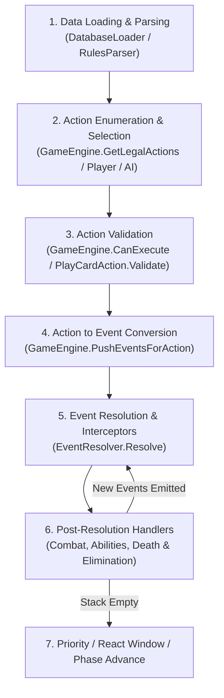

# Warlord CCG Engine - Codebase Map (`CODEBASE_MAP.md`)

This document serves as the comprehensive architectural reference and technical map for the Warlord CCG engine and CLI implementation.

---

## 1. Directory & Project Overview

The repository consists of a core CCG engine library, an interactive CLI front-end, and unit/integration test suites:

- **`src/` (`WarlordEngine`)**: The core class library implementing game models, deterministic rule verification, card loading, action execution, event-driven stack resolution, effect compilation, and AI agent search.
  - **`src/` (Root Models & Data)**: Foundational entities representing cards, players, board geometry, priority, attributes, database loaders, and game state snapshots.
  - **`src/Abilities/`**: Ability models representing parsed card abilities, triggers, timing windows, costs, and activation scopes.
  - **`src/Actions/`**: Player action definitions and validation logic. Encapsulates all legal decisions a player can propose (deploying, attacking, playing actions/items, marching, passing priority).
  - **`src/AI/`**: Artificial intelligence agents and heuristics for single-player play and simulations (Heuristic evaluation, Monte Carlo Tree Search).
  - **`src/Effects/`**: Executable atomic card effect primitives (damage, healing, stat buffs, saves, rolling attacks, rank movement) executed via an `EffectContext`.
  - **`src/Engine/`**: State machines, active game loop orchestration (`GameEngine`), rule parsing (`RulesParser`), passive stat calculation, combat resolution handlers, and death checking.
  - **`src/Events/`**: Event-driven architecture. Defines atomic state-mutating events (`GameEvent`), the priority interceptor stack (`EventResolver`), and post-resolution hooks.
- **`WarlordCli/`**: Console application providing human-playable terminal UI, full board visualization, ANSI-colored formatting, action grouping, and game loops against AI agents.
- **`tests/`**: Unit and integration test suites covering card mechanics, rules fidelity, AI rollouts, regressions, and board legality.

---

## 2. File-by-File Reference

---

### Root Engine Files (`src/`)

#### `src/AbilityTrigger.cs`
- **Purpose**: Defines triggers for card abilities.
- **Key State / Enums**: `AbilityTrigger` enum (`Order`, `SpendOrder`, `React`, `SpendReact`, `DeathReact`, `EnterReact`).
- **Methods**: N/A.

#### `src/Alignment.cs`
- **Purpose**: Defines character and card ethical/faction alignments.
- **Key State / Enums**: `Alignment` enum (`Good`, `Evil`, `Neutral`).
- **Methods**: N/A.

#### `src/AttackValue.cs`
- **Purpose**: Models attack power, composed of one or more strike descriptors.
- **Key Properties**:
  - `Strikes`: `IReadOnlyList<StrikeDescriptor>` (melee and ranged strikes).
  - `RawText`: `string` representing original card print attack string (e.g., `+3 / +0`).
- **Methods**: Record constructor/immutable record semantics.

#### `src/BoardGeometry.cs`
- **Purpose**: Pure static geometry engine for Warlord ranks, adjacency, melee/ranged legality, and rank-shift enforcement ("falling forward").
- **Key State Variables**:
  - `OnFormationNotice`: `Action<string>?` diagnostic callback for rank shifts.
- **Methods & Functions**:
  - `GetDistance(int rankA, int rankB)`: Returns the absolute rank distance between ranks within the same formation.
  - `GetCrossFormationDistance(int attackerRank, int defenderRank)`: Calculates distance between an attacker and an enemy defender (`attackerRank + defenderRank - 1`).
  - `GetCrossBoardDistance(int attackerRank, int defenderRank)`: Alias for cross-formation distance.
  - `IsRangedValid(int attackerRank, int defenderRank, int maxRange = 2)`: Validates if distance is within ranged weapon threshold.
  - `IsSameFormationRangedValid(int attackerRank, int allyRank)`: Validates distance between allies within the same player formation.
  - `IsMeleeValid(CardInstance attacker, CardInstance defender, GameState state)`: Validates melee striking capability (Rank 1 vs Rank 1, or Reach rules).
  - `IsRangedValid(CardInstance attacker, CardInstance defender, GameState state, int maxRange = 2)`: Checks ranged line-of-sight and range thresholds between card instances.
  - `GetValidRangedTargets(CardInstance attacker, int weaponRange, GameState state)`: Lists all opposing characters within legal ranged attack distance.
  - `FindCardRank(PlayerState player, int instanceId)` / `FindCardRank(GameState state, int playerIndex, int instanceId)`: Returns the rank number where a character currently sits.
  - `GetAdjacentCharacters(PlayerState player, int instanceId)`: Returns characters in adjacent slots/ranks.
  - `AreAdjacent(PlayerState player, int instanceId1, int instanceId2)` / `AreAdjacent(GameState state, ...)`: Validates card adjacency.
  - `IsFormationLegal(PlayerState player)`: Validates Warlord formation hierarchy rules (lower ranks cannot be empty if higher ranks are populated).
  - `CanDeployToRank(PlayerState player, int targetRank)`: Verifies if a newly played character can enter a specific rank.
  - `TrimTrailingEmptyRanks(PlayerState player)`: Removes empty trailing rank keys from dictionary.
  - `CollapseEmptyRanks(PlayerState player)`: Compacts ranks forward when entire ranks are wiped.
  - `ResolveIllegalRanks(PlayerState player)`: Re-balances formations when illegal gaps form.
  - `ResolveFallingForward(PlayerState player)`: Shifts higher-ranked units forward to fill gaps in accordance with Warlord CCG movement rules.
  - `EnforceFormation(PlayerState player)`: Master pipeline reconciling rank integrity after deaths or movement.

#### `src/CardDatabase.cs`
- **Purpose**: In-memory repository of all immutable card definitions.
- **Key Properties**:
  - `Definitions`: `IReadOnlyDictionary<string, CardDefinition>` mapping `definitionId` to card data.
- **Methods**:
  - `GetDefinition(string definitionId)`: Retrieves definition or null.

#### `src/CardDefinition.cs`
- **Purpose**: Immutable card metadata loaded from card rules data.
- **Key Properties**:
  - `DefinitionId`, `Name`, `Type` (`CardType`), `Class` (`CharacterClass?`), `Alignment` (`Alignment?`), `Faction`, `Level`, `ArmorClass`, `Skill`, `Attack`, `BaseHitPoints`, `Abilities`, `RulesText`, `CharacterType`, `IsWarlord`, `Traits`, `SkillRatings`, `SkillRequirements`.
  - `HasReach`: Evaluates if traits or rules specify Reach.
- **Methods**:
  - `GetEffectiveFaction()`: Returns faction or empty.
  - `IsUsableByClass(CharacterClass? charClass, IReadOnlyList<string>? charTraits = null)`: Validates class usability requirements.
  - `IsUsableByAlignment(Alignment? targetAlignment)`: Checks alignment compatibility for items/actions.

#### `src/CardInstance.cs`
- **Purpose**: Mutable in-game representation of an individual card on board, hand, deck, or discard.
- **Key Properties**:
  - `InstanceId`: Unique integer ID generated per game.
  - `DefinitionId`: Reference to card definition.
  - `CurrentHitPoints`, `Wounds`, `CurrentArmorClass`, `CurrentSkill`, `BonusLevel`.
  - `ReadyState`: `Ready`, `Spent`, `Stunned`.
  - `Zone`: Current card zone (`Deck`, `Hand`, `InPlay`, `Discard`, `BanishPile`).
  - `OwnerPlayerIndex`: Index of the player controlling the card.
  - `Rank`: Current rank on the battlefield (null if not in play).
  - `AttachedItemIds`: List of attached item `InstanceId`s.
  - `AttachedToInstanceId`: ID of character this item is attached to.
  - `StatusTags`: Active tags and flags (e.g., ephemeral buffs).
  - `SkillRatings`: Active modified skill ratings.
  - `AbilitiesUsedThisTurn`: Tracks once-per-turn / limited activations.
- **Methods**:
  - `DeepClone()`: Creates an isolated, deep copy for simulation/MCTS.

#### `src/CardType.cs`
- **Purpose**: Card category enum (`Character`, `Action`, `Item`, `Token`).

#### `src/CardZone.cs`
- **Purpose**: Enumeration of zones (`Deck`, `Hand`, `InPlay`, `DiscardPile`, `BanishPile`).

#### `src/CharacterClass.cs`
- **Purpose**: Bitwise/enum class distinctions (`Fighter`, `Wizard`, `Rogue`, `Cleric`).

#### `src/DatabaseLoader.cs`
- **Purpose**: Deserializes raw card JSON files, cleans text artifacts, parses skill ratings, and builds `CardDatabase`.
- **Key State / Types**:
  - `CardDto`, `StrikeDto`: Deserialization data transfer objects.
  - `SkillRatingRegex`, `ExcludedSkillWords`, `KnownWarlordDefinitionIds`.
- **Methods**:
  - `LoadFromFile(string jsonFilePath)` / `LoadFromJson(string json)`: Deserializes JSON into populated `CardDatabase`.
  - `CleanUnicodeArtifacts(string? text)`: Strips non-standard characters and quotes.
  - `ParseSkillRatings(string text)`: Extracts named skills and values from character rules text.
  - `MapToDefinition(CardDto dto)`: Maps DTO to `CardDefinition`.
  - `ParseClass(string? raw)`: Parses primary class and multiclass traits.
  - `ParseAlignment(string? raw)`: Maps alignment string to enum.
  - `BuildAttackRawText(List<StrikeDescriptor> strikes)`: Reconstructs readable strike string.

#### `src/DataPaths.cs`
- **Purpose**: Static resolver for engine data paths (`DataParser/cards.json`, `DataParser/starter_decks.json`).
- **Methods**:
  - `Resolve(string fileName)`: Traverses working directories to locate standard game data files.

#### `src/Deck.cs`
- **Purpose**: Immutable specification of a deck list (Warlord, starting characters, main deck).
- **Key Properties**:
  - `DeckName`, `Faction`, `WarlordDefinitionId`, `CardDefinitionIds`, `StartingCharacterDefinitionIds`.
  - `TotalCardCount`: Computed total count.
- **Methods**:
  - `Validate(CardDatabase cardDb, int minCardCount = 50)`: Validates deck legality against game rules and minimum size.

#### `src/GameOverReason.cs`
- **Purpose**: Enumeration indicating how the match concluded (`WarlordDefeated`, `DeckExhausted`, `Concession`).

#### `src/GameState.cs`
- **Purpose**: Complete snapshot of the match state, suitable for serialization and MCTS cloning.
- **Key Properties**:
  - `Players`: List of `PlayerState` (player 0 and 1).
  - `TurnState`: Active turn numbers, phases, and priority pass tracking.
  - `AutoPassWhenNoReactsAvailable`: Automation flag for react windows.
  - `PendingEvents`: List of unresolved events awaiting processing.
  - `TurnNumber`, `ActivePlayerIndex`, `CurrentPhase`, `Priority`: Convenience accessors into `TurnState`.
  - `IsGameOver`, `WinningPlayerIndex`, `InitiativeWinnerIndex`, `GameOverReason`.
  - `NextInstanceId`: Auto-incrementing identifier for newly spawned instances.
  - `IsSimulation`: Flag marking cloned simulation states to disable verbose logs.
- **Methods**:
  - `Clone()` / `DeepClone(int? observerPlayerId = null)`: Performs full deep cloning with optional hidden zone determinization for imperfect information simulation.
  - `DeterminizeHiddenZones(PlayerState opponent)`: Shuffles unknown cards in hand and deck to avoid clairvoyant MCTS rollout bias.

#### `src/PlayerState.cs`
- **Purpose**: Owns all zone collections and rank layouts for a single player.
- **Key Properties**:
  - `PlayerIndex`: 0 or 1.
  - `DisplayName`: Player screen name.
  - `Deck`, `Hand`, `DiscardPile`, `AttachedItems`, `BanishPile`: Lists of `CardInstance`.
  - `Ranks`: `SortedDictionary<int, List<CardInstance>>` mapping rank number (1-based) to characters.
  - `WarlordInstanceId`: Card instance ID of the player's Warlord.
  - `IsSimulation`: Simulation flag.
- **Methods**:
  - `DeepClone()`: Deeply clones all card collections, ranks, and attached items.
  - `CloneCardList(List<CardInstance> source)` / `CloneRanks(...)`: Helper methods for deep cloning.

#### `src/PresetDeckFactory.cs`
- **Purpose**: Parses pre-constructed starter decks and generates standard faction decks.
- **Key State / Types**:
  - `StarterDeckDto`, `DeckCardEntryDto`.
- **Methods**:
  - `FindStarterDecksJsonPath(...)`: Finds starter deck JSON.
  - `LoadStarterDecks(...)` / `LoadStarterDecksFromJson(...)`: Loads preset decks.
  - `BuildDeckFromDto(...)`: Builds validated `Deck` object from JSON DTO.
  - `GetSixFactionStarterDecks(...)`: Returns official faction decks.
  - `GeneratePresetDecks(...)` / `BuildDeckForWarlord(...)`: Dynamically builds legal decks around a chosen Warlord.

#### `src/PriorityState.cs`
- **Purpose**: Manages active turn priority, passes, and react windows.
- **Key Properties**:
  - `ActivePlayerIndex`: Current player with priority.
  - `HasPassed`: Indicates whether current active player passed.
  - `ConsecutivePasses`: Number of consecutive passes across players (2 passes end the phase).
  - `IsReactWindowOpen`: Whether a react window is currently awaiting responses.
- **Methods**:
  - `DeepClone()`: Clones priority state.

#### `src/ReactTiming.cs`
- **Purpose**: Enum describing when a react triggers (`AfterAttackDeclared`, `BeforeDamageDealt`, `AfterCharacterKilled`, `AfterMovement`).

#### `src/ReadyState.cs`
- **Purpose**: Card ready states (`Ready`, `Spent`, `Stunned`).

#### `src/SerializationConfig.cs`
- **Purpose**: Global JSON serialization settings for engine records and states.
- **Key Properties**:
  - `DefaultOptions`: Configured `JsonSerializerOptions`.

#### `src/StrikeDescriptor.cs`
- **Purpose**: Defines an individual attack strike.
- **Key Properties**:
  - `Modifier`: Attack roll bonus (e.g., +2).
  - `IsRanged`: True if strike is ranged; false if melee.

#### `src/TargetScope.cs`
- **Purpose**: Enum specifying target requirements (`AnyCharacter`, `EnemyInRank`, `AdjacentAlly`, `FriendlyCharacter`, `Self`).

#### `src/TurnPhase.cs`
- **Purpose**: Warlord turn phases (`DeployStartingArmy`, `Initiative`, `Action`, `Reset`).

---

### Abilities Subsystem (`src/Abilities/`)

#### `src/Abilities/AbilityDefinition.cs`
- **Purpose**: Immutable blueprint of an ability parsed from rules text or defined in code.
- **Key Properties**:
  - `Trigger`: `AbilityTrigger` (`Order`, `React`, etc.).
  - `IsLimited`: Whether marked as "Limited" (usable once per turn).
  - `Effects`: `IReadOnlyList<IEffect>` to evaluate on activation.
  - `Description`: Rules text summary.
  - `Timing`: `ReactTiming`.
  - `RequiredPerformerClass`: Class restrictions on performing character.
  - `SplitSecond`: If true, cannot be reacted to.
  - `TargetScope`: `TargetScope` constraint.
  - `MaxRankDistance`: Distance limit for ability targeting.
  - `RequiresSpend`, `DestroysSource`, `DiscardHandCost`, `RequiresSpendAdjacentAlly`, `RequiresSpendAllyInRank`, `BanishActionFromDiscardCost`, `DiscardsOpponentTopDeck`, `StunSelfCost`: Activation cost flags.
  - `IsActive`, `IsReact`: Helper properties.

---

### Actions Subsystem (`src/Actions/`)

#### `src/Actions/IPlayerAction.cs` & `PlayerAction.cs`
- **Purpose**: Marker interface and base abstract record for all player decisions.
- **Key Properties**:
  - `PlayerIndex`: Player performing the action.

#### `src/Actions/ActionResult.cs`
- **Purpose**: Standard result wrapper returned by action validation.
- **Key Properties**:
  - `IsSuccess`: Boolean status.
  - `Errors`: Read-only list of validation failure strings.
- **Methods**:
  - `Success()`, `Failure(params string[] errors)`: Factory methods.

#### `src/Actions/AttackAction.cs` & `src/Actions/DeclareAttackAction.cs`
- **Purpose**: Declares an attack by an attacker against a target defender.
- **Key Properties**:
  - `AttackerInstanceId`, `TargetInstanceId` / `DefenderInstanceId`, `TargetInstanceIds`.

#### `src/Actions/DeployCharacterAction.cs`
- **Purpose**: Deploys a character from hand to a target rank.
- **Key Properties**:
  - `DefinitionId`: Card to deploy.
  - `TargetRank`: Destination rank.

#### `src/Actions/DeployStartingArmyAction.cs` & `StartingCharacterDeployment.cs`
- **Purpose**: Deploys initial starting characters and warlord during the setup phase.
- **Key Properties**:
  - `Deployments`: `IReadOnlyList<StartingCharacterDeployment>` (pairs of `CardInstanceId` and `TargetRank`).

#### `src/Actions/DiscardCardAction.cs`
- **Purpose**: Discards a card from hand (e.g. during reset or as a cost).
- **Key Properties**:
  - `CardInstanceId`: Hand card instance ID.

#### `src/Actions/MarchAction.cs` & `src/Actions/JourneyAction.cs`
- **Purpose**: Moves a character forward/backward or sideways across ranks.
- **Key Properties**:
  - `CardInstanceId`: Character moving.
  - `SourceRank`, `DestinationRank`: Ranks moved between.
  - `TargetSlotIndex`: Optional slot position in destination rank.

#### `src/Actions/PassAction.cs` & `PassPriorityAction.cs`
- **Purpose**: Passes priority or action turn.
- **Methods**:
  - `Execute(GameState state)`: Mutates priority state and pass counts.

#### `src/Actions/PlayCardAction.cs`
- **Purpose**: Complex action representing playing an Action or equipping an Item from hand. Contains full requirement validation.
- **Key Properties**:
  - `CardInstanceId`, `TargetRank`, `TargetCharacterId`, `PerformerInstanceId`, `AbilityIndex`, `ChoiceIndex`, `DiscardCardInstanceId`, `CostCharacterInstanceId`, `CostBanishCardInstanceIds`.
- **Methods & Functions**:
  - `ExtractSkillRequirements(CardDefinition / string / tags)`: Parses requirements like "Requires Fighter +3".
  - `Validate(GameState state, CardDatabase cardDb)`: Validates uniqueness, performer availability, readiness, hand presence, class restrictions, and item slots.
  - `GetItemEquipmentSlots(CardDefinition itemDef)`: Determines weapon/armor/shield/accessory slots.
  - `MatchesClass(CardDefinition actionDef, CardDefinition performerDef)`: Checks class compatibility.
  - `ValidateItemEquip(...)`: Checks slot limits and alignment when equipping items.
  - `ValidatePerformerRequirements(...)`: Ensures performer meets class, level, and ready state.
  - `ValidateSkillRequirements(...)`: Checks performer's skill ratings against card requirements.

#### `src/Actions/UseAbilityAction.cs`
- **Purpose**: Activates an on-board order or react ability on an in-play card.
- **Key Properties**:
  - `SourceInstanceId`, `AbilityIndex`, `ChoiceIndex`, `TargetInstanceIds`, cost IDs (`DiscardCardInstanceId`, `CostCharacterInstanceId`, `CostBanishCardInstanceIds`).

---

### AI Subsystem (`src/AI/`)

#### `src/AI/IAiAgent.cs` & `IStateEvaluator.cs`
- **Purpose**: Contracts for bot agents and board evaluators.
- **Methods**:
  - `SelectAction(GameState state, GameEngine engine, int playerId, CancellationToken ct)`: Selects optimal action.
  - `Evaluate(GameState state, int maximizingPlayerId)`: Returns numeric heuristic score.

#### `src/AI/BoardStateEvaluator.cs`
- **Purpose**: Heuristic board state evaluator measuring Warlord survival, card advantage, board presence, wounds, and rank positioning.
- **Methods**:
  - `Evaluate(GameState state, int maximizingPlayerId)`: Computes relative player delta.
  - `EvaluatePlayer(PlayerState player)`: Scores individual player based on character count, levels, wounds, AC, and item bonuses.

#### `src/AI/HeuristicAiAgent.cs`
- **Purpose**: 1-ply greedy lookahead agent evaluating all legal action outcomes.
- **Methods**:
  - `SelectAction(...)`: Simulates each legal action on a cloned state, runs reactive windows to completion, and picks the highest heuristic score.
  - `DrainReactWindow(...)`: Fast-forwards react windows in simulation.

#### `src/AI/MctsAiAgent.cs`
- **Purpose**: Monte Carlo Tree Search agent implementing UCB1 exploration and random rollouts for deep decision making.
- **Key State / Types**:
  - `MctsNode`: Node representing tree action, parent, visits, and total reward.
  - `Iterations`, `ExplorationConstant`, `MaxRolloutSteps`.
- **Methods**:
  - `SelectAction(...)`: Runs selection, expansion, simulation/rollout, and backpropagation loops.
  - `SelectRolloutAction(...)`: Random rollout action policy favoring attacks and orders over passes.
  - `DrainReactWindow(...)`: Clears simulation react windows.

---

### Effects Subsystem (`src/Effects/`)

#### `src/Effects/IEffect.cs` & `EffectContext.cs`
- **Purpose**: Core effect abstraction and execution context.
- **Key Properties on `EffectContext`**:
  - `SourceInstanceId`, `PerformerInstanceId`, `TargetInstanceId`, `TargetInstanceIds`, `State`, `CardDb`, `RollDice`, `OnAttackResolved`.
- **Context Methods**:
  - `GetPerformerCharacterId()`, `GetPerformerCharacter()`, `FindCard(int instanceId)`.

#### `src/Effects/DiceRoller.cs`
- **Purpose**: Delegate signature `int DiceRoller(int minInclusive, int maxInclusive)`.

#### `src/Effects/AttackResolutionDetails.cs` & `StrikeTargetPrompt.cs`
- **Purpose**: DTOs capturing combat dice rolls, modifiers, hits, criticals, wounds, and interactive multi-strike prompts.

#### Atomic & Card-Specific Effect Records (`src/Effects/*`)
- **`DealDamageEffect`**: Emits `DealDamageEvent` for specified damage and type.
- **`HealEffect`**: Reduces wounds on target card.
- **`DrawCardEffect`**: Emits `DrawCardEvent` for active player.
- **`ChangeReadyStateEffect`**: Alters target `ReadyState` (`Spent`, `Stunned`, `Ready`).
- **`ModifyStatEffect`**: Buffs or debuffs stats (Atk, AC, Skill, HP).
- **`MoveRankEffect`**: Shifts target forward/backward by rank delta or to destination rank.
- **`PerformStrikeEffect`**: Generates full strike resolution against target with bonuses, critical rules, stun/spend riders, and range rules.
- **`ResolveAttackEffect`**: Core combat resolution calculating d20 roll + attack modifiers against target AC, handling critical hits (natural 20), critical misses (natural 1), and damage application.
- **`RollTableEffect` & `RollTableBranch`**: Evaluates roll-order tables based on d20 roll results.
- **`FortitudeSaveEffect`, `ReflexSaveEffect`, `WillSaveEffect`**: Roll d20 + stat checks against Difficulty Class (DC), executing failure effects if failed.
- **`PermanentLevelUpEffect`**: Applies permanent level-up stat increases.
- **`GrantAdditionalStrikeEffect` & `GrantTraitEffect`**: Bestows ephemeral strikes or traits.
- **`PreventWoundsEffect` & `FateshiftEffect`**: Cancels or reduces incoming wounds.
- **`PutCharacterIntoPlayEffect`**: Summons or recruits characters directly to ranks.
- **`DestroyTargetItemEffect` & `SalvageEquippedItemEffect`**: Destroys or retrieves equipped items.
- **`RedirectStrikeEffect`**: Deflects incoming attack to an adjacent ally.
- **Named Card Effects**: `FireballEffect`, `MagicMissilesEffect`, `ShadowBoltsEffect`, `AnotherTavernBrawlEffect`, `BanishFromDiscardAndStrikeEffect`, `HrunInstigatorEffect`, `JourneyEffect`, `MeetAtTheInnEffect`, `PackTacticsEffect`, `RepositionInRankEffect`, `StrongarmStoutEffect`, `SurveyEffect`, `TargetHigherLevelDeverenianJourneyEffect`, `TargetPerformsStrikeEffect`, `TheMightyMuggEffect`, `WellSuppliedEffect`.

---

### Engine Core Subsystem (`src/Engine/`)

#### `src/Engine/GameEngine.cs`
- **Purpose**: Central facade managing game setup, action validation, execution pipeline, phase flow, and combat resolution handlers.
- **Key State Variables**:
  - `_state`: Active `GameState`.
  - `_resolver`: Active `EventResolver` queue and stack.
  - `_cardDb`: Card database.
  - `_diceRoller`: Dice roller function.
  - `LastInitiativeRoll`, `InitiativeTieHistory`: Turn initiative tracking.
  - `OnAttackResolved`: Event callback for combat logs.
  - `SelectStrikeTarget`: Hook for targeting multi-strike attacks.
- **Key Methods & Functions**:
  - `CreateFromDecks(...)`: Factory initializing players, shuffling, and setting starting army phase.
  - `GetLegalActions(int playerId)` / `GetLegalActions(GameState state, int playerId)`: Enumerates all valid actions (play card, attack, ability, march, pass) based on current phase and priority.
  - `CanExecute(PlayerAction action)` / `Validate...`: Validates legality of proposed actions.
  - `Execute(PlayerAction action)` / `ExecuteAction(...)`: Entry point to execute action, convert to events, and drain the resolver.
  - `RollInitiative()`: Resolves d20 initiative roll + modifiers for both players, rerolling ties.
  - `AdvancePhase()`: Transitions through `Initiative -> Action -> Reset -> Initiative`, unstunning/unspending cards during reset.
  - `DrainResolverStack(...)` / `ResolveReactWindowStack()`: Drains events from `EventResolver`, opening react windows when required events arise.
  - `GetContinuousPassiveBonuses(...)` / `GetEffectiveAttack / ArmorClass / Skill / Level`: Computes dynamically modified character stats taking attached items and active buffs into account.

#### `src/Engine/RulesParser.cs`
- **Purpose**: Regex compilation engine parsing raw card rules text into executable `AbilityDefinition`s, triggers, and traits.
- **Key State**:
  - `TriggerMap`: Maps keywords (`Order`, `Spend Order`, `React`, `Death React`, etc.) to `AbilityTrigger`.
  - `EffectMatchers`: List of regex matcher delegates extracting atomic effects.
- **Methods**:
  - `Parse(string rulesText, string? cardName = null)`: Parses text into `List<AbilityDefinition>`.
  - `ParseRollOrderAbility(...)`: Parses tabular roll order rules.
  - `ParseTimingAndScope(...)`: Extracts react timing and targeting constraints.
  - `HasStealth / Riposte / MagicResistance`, `GetStealthRating / RiposteRating / MagicResistanceRating`: Helper methods extracting keywords and ratings.

#### `src/Engine/TurnState.cs`
- **Purpose**: Tracks turn progression and pass counts.
- **Key Properties**:
  - `ActivePlayerIndex`, `CurrentPhase`, `TurnNumber`, `Priority`, `UsedLimitedAbilityKeysThisTurn`.
- **Methods**:
  - `RecordPass()`: Increments pass counters.
  - `RecordAction()`: Resets consecutive pass count.
  - `AdvancePhase()`: Updates phase enum and resets priority counters.

#### `src/Engine/PassiveBonuses.cs`
- **Purpose**: Accumulator record storing net bonuses from items and traits (`Atk`, `Ac`, `Hp`, `Skill`, `AdditionalWounds`, `TrueStrike`, `HasReach`, `AdditionalStrikes`).

#### `src/Engine/CombatContext.cs`
- **Purpose**: Contextual descriptor passed to passive calculations (`IsAttacking`, `IsDefending`, `OpponentCard`, `IsMelee`, `IsRanged`).

#### Post-Resolution Handlers (`src/Engine/*Handler.cs`)
- **`AbilityEffectHandler`**: Intercepts `AbilityActivatedEvent` and executes its compiled `IEffect` list.
- **`DeathCheckHandler`**: Evaluates all characters after damage events; emits `CharacterDefeatedEvent` when wounds meet or exceed hit points.
- **`WarlordEliminationHandler`**: Watches for `CharacterDefeatedEvent` on a Warlord; immediately emits `GameOverEvent`.
- **`AttackResolutionHandler` (inside `GameEngine.cs`)**: Orchestrates strike loops, advantage/disadvantage, strike target prompts, and damage calculations.
- **`MagicDamageResistanceHandler` (inside `GameEngine.cs`)**: Mitigates magical damage for targets with Magic Resistance.
- **`AttachedItemDefeatHandler` (inside `GameEngine.cs`)**: Cleans up attached items when carrier character dies.

---

### Events Subsystem (`src/Events/`)

#### `src/Events/GameEvent.cs` & `src/Events/ResolveResult.cs`
- **Purpose**: Base abstract class for atomic events and the result records produced by `EventResolver`.
- **Methods on `GameEvent`**:
  - `ApplyToState(GameState state)`: Pure state mutator executing the event's effects on `GameState`.

#### `src/Events/EventResolver.cs`
- **Purpose**: Central LIFO event stack and interceptor pipeline.
- **Key State Variables**:
  - `_eventStack`: `Stack<GameEvent>`.
  - `_interceptors`: `List<IEventInterceptor>`.
  - `_postHandlers`: `List<IPostResolutionHandler>`.
- **Methods**:
  - `Push(GameEvent gameEvent)`: Pushes event to stack.
  - `RequiresReactWindow(GameEvent gameEvent)`: Returns true if event allows react responses.
  - `Resolve(GameState state)`: Pops event, runs interceptors (Allow / Cancel / Modify), applies to state, and triggers post-resolution handlers.
  - `ResolveAll(GameState state)`: Continuously resolves stack until empty.

#### `src/Events/IEventInterceptor.cs` & `IPostResolutionHandler.cs`
- **Purpose**: Interfaces for modifying events before state application, or spawning subsequent events after state application.

#### Event Record Definitions (`src/Events/*Event.cs`)
- **`AbilityActivatedEvent`**: Marks ability usage and spends costs.
- **`ChangeReadyStateEvent`**: Mutates card ready state (`Ready`, `Spent`, `Stunned`).
- **`CharacterDefeatedEvent`**: Removes character from board ranks to discard or banish pile.
- **`CharacterMovedEvent` / `MarchEvent`**: Shifts character across ranks.
- **`DealDamageEvent`**: Applies wounds to a card instance.
- **`DeclareAttackEvent`**: Triggers attack resolution.
- **`DrawCardEvent`**: Moves top card of deck to hand.
- **`GameOverEvent`**: Sets game over flags and winner.
- **`ModifyStatEvent`**: Modifies persistent stats.
- **`PhaseChangeEvent`**: Updates turn phase.
- **`PlayCardEvent`**: Places card into play from hand.
- **`PreventWoundsEvent`**: Cancels pending wound application.
- **`RollD20Event`**: Records a d20 roll against a target DC.

#### `src/Events/CardLocator.cs`
- **Purpose**: Utilities to locate and safely mutate `CardInstance` structs across any player zone or rank.
- **Methods**:
  - `FindCard(GameState state, int instanceId)`: Searches hands, ranks, decks, and attached items.
  - `FindAndMutate(GameState state, int instanceId, CardMutator mutator)`: Mutates a card struct in-place within its containing collection.
  - `ResolvePerformerCharacterId(...)` / `ResolvePerformerCharacter(...)`: Finds carrier character if given an attached item ID.

---

### CLI Application (`WarlordCli/Program.cs`)

- **Purpose**: Interactive terminal front-end for playing matches, rendering board layouts, and inspecting actions.
- **Key State / Types**:
  - `ActionGroup`: Groups legal actions by type (`Attacks`, `Orders`, `Movement`, `Card Plays`, `Pass`).
- **Methods & Functions**:
  - `Main(string[] args)`: Entry point; handles game setup, deck loading, human vs AI game loop, and victory screens.
  - `RenderScreen(...)`: Renders ranks, hands, stats, active priority, and initiative history to terminal.
  - `FormatCharacter(...)`: Formats card stats (Atk, AC, HP, Wounds, ReadyState, Items) with ANSI colors.
  - `FormatAction(...)`, `FormatAttack(...)`, `FormatPlayCard(...)`, `FormatUseAbility(...)`: Human-readable descriptions of actions.
  - `GroupLegalActions(...)`: Organizes raw engine legal actions into navigable menu groupings.
  - `FindCardsJsonPath()`: Helper locating `cards.json`.

---

## 3. Engine Execution Lifecycle

The lifecycle of an action in the Warlord CCG engine progresses through five distinct stages:

### Stage 1: Card Loading & Ability Compilation
1. **JSON Ingestion**: `DatabaseLoader.LoadFromFile()` reads `cards.json`.
2. **Text Sanitation**: Strips Unicode formatting issues and standardizes whitespace.
3. **Trait & Skill Parsing**: Regex extracts keywords (`Stealth`, `Riposte`, `Magic Resistance`) and numerical skill ratings.
4. **Rules Text Parsing**: `RulesParser.Parse()` matches rules text lines against `TriggerMap` (`Order`, `React`, `Spend Order`, etc.) and compiles matching regex patterns into atomic `IEffect` implementations (e.g. `DealDamageEffect`, `PerformStrikeEffect`).
5. **Database Storage**: Resulting `CardDefinition` instances are indexed in `CardDatabase`.

### Stage 2: Action Enumeration
1. **Turn & Phase Context**: Depending on `state.CurrentPhase` (`DeployStartingArmy`, `Initiative`, `Action`, `Reset`):
   - **`DeployStartingArmy`**: Emits `DeployStartingArmyAction` permutations.
   - **`Initiative`**: Automatically rolls initiative d20 + modifiers.
   - **`Action Phase`**: `GameEngine.GetLegalActions(playerId)` queries:
     - All characters on board ready to declare melee or ranged attacks (`DeclareAttackAction`).
     - In-play cards with legal `Order` abilities (`UseAbilityAction`).
     - Cards in hand with legal deploy ranks, item targets, or action performers (`PlayCardAction`).
     - Board characters with legal destination ranks (`MarchAction`).
     - `PassAction`.
2. **Action Selection**: Human player selects action via `WarlordCli`, or AI selects action via `HeuristicAiAgent` / `MctsAiAgent`.

### Stage 3: Validation
1. Before execution, `GameEngine.CanExecute(action)` runs strict validation checks.
2. For card plays (`PlayCardAction.Validate`):
   - Validates player owns card in hand.
   - Ensures Unique card restrictions are respected.
   - For items: verifies target character exists, has available equipment slots, and meets alignment/class requirements.
   - For actions: verifies a legal performer character is specified and ready, and meets skill requirements.
3. For attacks (`ValidateAttackAction` / `ValidateAttack`):
   - Verifies attacker is ready (not spent/stunned).
   - Validates rank distance and line-of-sight via `BoardGeometry.IsMeleeValid` or `BoardGeometry.IsRangedValid`.
   - Checks target is not protected by `Stealth`.

### Stage 4: Conversion to Events
1. Once validated, `GameEngine.PushEventsForAction(action)` translates player intent into initial atomic events:
   - `PlayCardAction` $\rightarrow$ Spends costs (discard, spend performer), then pushes `PlayCardEvent`.
   - `DeclareAttackAction` $\rightarrow$ Spends attacker (sets spent), pushes `DeclareAttackEvent`.
   - `UseAbilityAction` $\rightarrow$ Deducts ability costs, pushes `AbilityActivatedEvent`.
   - `MarchAction` $\rightarrow$ Spends character, pushes `MarchEvent`.

### Stage 5: Event Stack Resolution & React Windows
1. Events reside on the `EventResolver` stack.
2. If the top event requires a react window (`EventResolver.RequiresReactWindow` returns true for `DeclareAttackEvent`, `AbilityActivatedEvent`, `MarchEvent`, `DealDamageEvent`):
   - The engine opens a react window (`PriorityState.IsReactWindowOpen = true`).
   - Priority alternates between players to trigger eligible `React` abilities.
   - React abilities resolve on top of the stack (LIFO).
3. Once react windows close, `EventResolver.Resolve(state)` processes the event:
   - Interceptors (`IEventInterceptor`) inspect the event to Allow, Cancel, or Modify it.
   - `event.ApplyToState(state)` directly mutates `GameState`.

### Stage 6: Post-Resolution Handlers, Combat & Death
1. `EventResolver` passes the resolved event to registered `IPostResolutionHandler`s:
   - **`AttackResolutionHandler`**:
     - Intercepts `DeclareAttackEvent`.
     - Applies turn buffs (True Strike, Advantage/Disadvantage, Riposte).
     - Queries attacker strike descriptors and rolls d20 + attack bonus vs defender AC.
     - Handles critical hits (natural 20 doubles or guarantees hits) and critical misses (natural 1).
     - Pushes `DealDamageEvent` onto the stack for hits.
   - **`AbilityEffectHandler`**:
     - Intercepts `AbilityActivatedEvent`.
     - Builds `EffectContext` and evaluates each `IEffect`, pushing generated events to the stack.
   - **`DeathCheckHandler`**:
     - Intercepts `DealDamageEvent`.
     - Checks all board characters. If `Wounds >= CurrentHitPoints`, pushes `CharacterDefeatedEvent`.
   - **`WarlordEliminationHandler`**:
     - Intercepts `CharacterDefeatedEvent`.
     - If the defeated card is a player's Warlord, pushes `GameOverEvent`, terminating the match.
2. The stack drains recursively until all triggered events and secondary reactions have resolved.
3. `BoardGeometry.EnforceFormation(player)` executes, collapsing empty ranks and falling higher-ranked characters forward.
