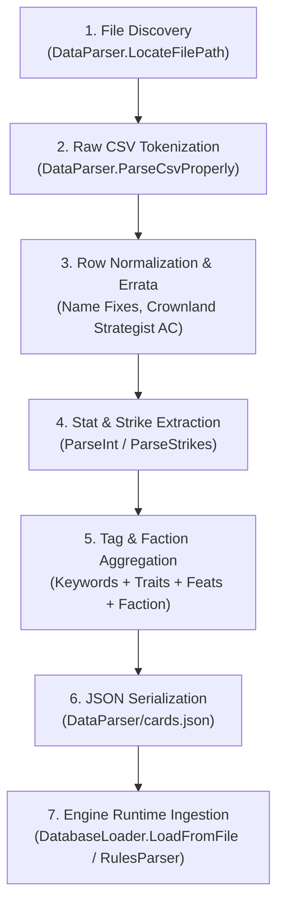

# Warlord CCG DataParser - Codebase Map (`DataParser_CODEBASE_MAP.md`)

This document serves as the comprehensive architectural reference and technical map for the `DataParser` project (`DataParser/`), which is responsible for ingestion, normalization, and compilation of raw Warlord CCG card spreadsheet data into the structured JSON format consumed by the core engine.

---

## 1. Directory & Project Overview

The `DataParser/` folder contains a standalone .NET 8 console utility that converts raw CSV card data (`WarlordCards.csv`) into the engine's canonical `cards.json` database file:

- **[`DataParser/DataParser.csproj`](file:///c:/Users/markf/Warlord-CCG/DataParser/DataParser.csproj)**: The project file configuring the build target (`net8.0` executable, implicit usings, and nullable reference types).
- **[`DataParser/Program.cs`](file:///c:/Users/markf/Warlord-CCG/DataParser/Program.cs)**: Contains both the top-level CLI entry point and the `DataParser` class housing the RFC-4180 CSV state machine, field normalizers, errata patchers, and JSON serializer.
- **Data Artifacts (Located in `DataParser/`)**:
  - `WarlordCards.csv`: The raw input spreadsheet containing card names, stats, classes, alignments, traits, factions, and rules text.
  - `cards.json`: The generated output artifact read at runtime by [`DatabaseLoader`](file:///c:/Users/markf/Warlord-CCG/src/DatabaseLoader.cs) and [`DataPaths`](file:///c:/Users/markf/Warlord-CCG/src/DataPaths.cs) in `WarlordEngine`.
  - `starter_decks.json`: Pre-configured faction starter deck definitions referenced by [`PresetDeckFactory`](file:///c:/Users/markf/Warlord-CCG/src/PresetDeckFactory.cs).

---

## 2. File-by-File Reference

---

### Project Configuration (`DataParser/DataParser.csproj`)

#### [`DataParser/DataParser.csproj`](file:///c:/Users/markf/Warlord-CCG/DataParser/DataParser.csproj)
- **Purpose**: MSBuild project definition for the `DataParser` standalone executable.
- **Key Properties & Settings**:
  - `OutputType`: `Exe` (Console executable).
  - `TargetFramework`: `net8.0`.
  - `ImplicitUsings`: `enable`.
  - `Nullable`: `enable`.
- **Dependencies**: Uses standard BCL `System.Text.Json` and `System.IO` without external NuGet packages.

---

### Source Files (`DataParser/Program.cs`)

#### [`DataParser/Program.cs`](file:///c:/Users/markf/Warlord-CCG/DataParser/Program.cs)
- **Purpose**: Top-level CLI bootstrap and the [`DataParser`](file:///c:/Users/markf/Warlord-CCG/DataParser/Program.cs#L25-L290) static utility class that locates `WarlordCards.csv`, parses multiline quoted CSV records, applies card-specific errata and canonical naming fixes, extracts multi-strike arrays and trait tags, and serializes the resulting schema to `cards.json`.
- **Key State Variables & Local Structures**:
  - `csvPath` (`string`, lines 11–18): Resolved absolute path to `WarlordCards.csv`.
  - `outputJsonPath` (`string`, line 21): Target output path (`<DataParserDir>/cards.json`).
  - `headers` (`List<string>`, line 64): Trimmed header column names extracted from row `0` of the CSV.
  - `cardDefinitions` (`List<Dictionary<string, object>>`, line 65): Accumulator list holding the dynamically shaped JSON objects for each valid card row.
  - `cardDef` (`Dictionary<string, object>`, lines 103–201): Per-card key-value map containing `DefinitionId`, `Name`, `Type`, `Class`, `Alignment`, `RulesText`, optional numeric stats (`Level`, `AC`, `Skill`, `BaseHp`, `Strikes`), `CharacterType`, and deduplicated `Tags`.
- **Methods & Functions**:
  - **Top-Level Entry Point ([`Program.cs`](file:///c:/Users/markf/Warlord-CCG/DataParser/Program.cs#L9-L23))**:
    - Calls [`DataParser.LocateFilePath("WarlordCards.csv")`](file:///c:/Users/markf/Warlord-CCG/DataParser/Program.cs#L27-L45) to find the input file regardless of whether the binary is launched from `bin/Debug/net8.0/`, the project directory, or the repo root.
    - Computes `outputJsonPath` alongside the located CSV file and invokes [`DataParser.ParseCSV(csvPath, outputJsonPath)`](file:///c:/Users/markf/Warlord-CCG/DataParser/Program.cs#L47-L212).
  - **[`public static string LocateFilePath(string filename)`](file:///c:/Users/markf/Warlord-CCG/DataParser/Program.cs#L27-L45)**:
    - **Purpose**: Deterministic upward directory search starting from `AppContext.BaseDirectory`.
    - **Behavior**: Iteratively walks up `DirectoryInfo.Parent`, checking both `<dir>/<filename>` and `<dir>/DataParser/<filename>`. Avoids relying on `Environment.CurrentDirectory` so behavior is identical under `dotnet run`, test runners, and direct binary execution.
  - **[`public static void ParseCSV(string csvFilePath, string outputJsonPath)`](file:///c:/Users/markf/Warlord-CCG/DataParser/Program.cs#L47-L212)**:
    - **Purpose**: Main ETL (Extract-Transform-Load) pipeline converting the CSV file into `cards.json`.
    - **Local Helper Functions**:
      - `int ColIdx(string colName)` (line 67): Looks up the zero-based column index in `headers`.
      - `string GetCol(string[] cols, string colName)` (lines 68–72): Safely extracts and trims the cell value for a named column, returning `string.Empty` if out of bounds.
      - `void AddTags(string raw)` (lines 169–180): Splits comma-separated cell strings (`Keywords`, `Traits`, `Feats`) and appends non-empty, non-hyphen tokens into the card's `tags` list.
    - **Transformation Rules & State Mutations**:
      1. **Canonical Name Normalization** (lines 84–91): Fixes known CSV typos (`"Adathyn Celestial Messenger"` → `"Adathan, Celestial Messenger"`, `"Vactus Spirit's Champion"` → `"Vactus, Spirit's Champion"`).
      2. **ID Generation** (line 105): Generates `DefinitionId` by replacing spaces with underscores and lowercasing `Name` (`name.Replace(" ", "_").ToLowerInvariant()`).
      3. **Rules Text Escaping** (lines 97–98): Strips carriage returns (`\r`) and converts literal newlines (`\n`) into escaped `\n` sequences.
      4. **Character vs. Non-Character Stat Emission** (lines 121–165):
         - For **Characters & Warlords** (`isCharacter == true`): Always emits `AC`, `Skill`, `BaseHp`, and `Strikes` (defaulting missing integers to `0`). Applies a known errata fix for `"Crownland Strategist"` (`AC` `4` → `14`).
         - For **Items & Actions** (`isCharacter == false`): Sparsely emits `AC`, `Skill`, `BaseHp`, and `Strikes` only when the CSV column is non-empty and not `"-"`.
      5. **Tag Aggregation & Deduplication** (lines 168–199): Combines `Keywords`, `Traits`, `Feats`, `Faction`, and `Character Type` into a case-insensitively deduplicated `Tags` list.
      6. **JSON Serialization** (lines 204–211): Serializes `cardDefinitions` with `WriteIndented = true` and `JavaScriptEncoder.UnsafeRelaxedJsonEscaping` (preserving literal `+` and `'` characters) and writes UTF-8 text to `outputJsonPath`.
  - **[`private static List<string[]> ParseCsvProperly(string text)`](file:///c:/Users/markf/Warlord-CCG/DataParser/Program.cs#L214-L265)**:
    - **Purpose**: Custom character-by-character state machine parser supporting RFC-4180 CSV rules.
    - **State Variables**:
      - `result` (`List<string[]>`): Completed rows.
      - `currentLine` (`List<string>`): Fields accumulated for the active row.
      - `currentField` (`StringBuilder`): Characters accumulated for the active cell.
      - `inQuotes` (`bool`): Tracks whether the cursor is currently inside a double-quoted string literal.
    - **Behavior**: Handles escaped double quotes (`""` → `"`), commas inside quoted strings, and embedded CRLF/LF newlines inside multiline rules text fields without prematurely splitting the row.
  - **[`private static int ParseInt(string val)`](file:///c:/Users/markf/Warlord-CCG/DataParser/Program.cs#L267-L272)**:
    - **Purpose**: Strips leading `+` signs and whitespace from numeric stat strings (e.g., `"+3"` → `3`) and parses to `int`, returning `0` on failure or empty input.
  - **[`private static List<Dictionary<string, int>> ParseStrikes(string attackStr)`](file:///c:/Users/markf/Warlord-CCG/DataParser/Program.cs#L274-L289)**:
    - **Purpose**: Splits slash-delimited attack strings (e.g., `"+6/+1"`) into an ordered list of strike dictionaries (`[{ "Bonus": 6 }, { "Bonus": 1 }]`). Returns an empty list if the input is empty or `"-"`.

---

## 3. DataParser Execution Lifecycle

The end-to-end lifecycle of how raw spreadsheet data flows through `DataParser` and into the `WarlordEngine` runtime is illustrated below:

### Stage 1: File Discovery (`LocateFilePath`)
1. When `DataParser` starts, [`LocateFilePath("WarlordCards.csv")`](file:///c:/Users/markf/Warlord-CCG/DataParser/Program.cs#L27-L45) walks upward from `AppContext.BaseDirectory`.
2. Once `DataParser/WarlordCards.csv` is found, its directory is locked as the target output folder for `cards.json`.

### Stage 2: RFC-4180 CSV Tokenization (`ParseCsvProperly`)
1. `File.ReadAllText` loads `WarlordCards.csv` as a UTF-8 string.
2. [`ParseCsvProperly`](file:///c:/Users/markf/Warlord-CCG/DataParser/Program.cs#L214-L265) iterates character-by-character, toggling `inQuotes` on unescaped `"` characters so embedded commas and multi-paragraph card rules text remain intact within a single cell.
3. Row `0` is extracted as the `headers` lookup table, mapping column names (`Name`, `Type`, `Character Type`, `Class`, `Alignment`, `Rules Text`, `Level`, `Armor Class`, `Skill`, `Hit Points`, `Attack`, `Keywords`, `Traits`, `Feats`, `Faction`) to array indices.

### Stage 3: Normalization, Errata & Stat Extraction (`ParseCSV`)
1. For each row `1..N`, blank rows or rows missing a `Name` are skipped.
2. Canonical card name fixes and stat errata (such as setting *Crownland Strategist*'s `AC` from `4` to `14`) are applied directly in memory.
3. Multi-strike strings (`+8/+3`) are split on `/` by [`ParseStrikes`](file:///c:/Users/markf/Warlord-CCG/DataParser/Program.cs#L274-L289) into structured strike objects (`{ "Bonus": 8 }`, `{ "Bonus": 3 }`).
4. Characters emit full combat stat blocks (`AC`, `Skill`, `BaseHp`, `Strikes`), whereas Action and Item cards only include stat keys that are explicitly populated in the CSV.

### Stage 4: Tag Consolidation & JSON Export
1. Comma-delimited values from `Keywords`, `Traits`, and `Feats` are merged with `Faction` and `Character Type` into a single deduplicated `Tags` array.
2. `JsonSerializer.Serialize` writes the completed `List<Dictionary<string, object>>` to `DataParser/cards.json` using `UnsafeRelaxedJsonEscaping` for clean human readability.

### Stage 5: Downstream Handoff to `WarlordEngine`
1. At game startup, [`DataPaths.CardsJsonPath`](file:///c:/Users/markf/Warlord-CCG/src/DataPaths.cs#L157) locates `DataParser/cards.json`.
2. [`DatabaseLoader.LoadFromFile`](file:///c:/Users/markf/Warlord-CCG/src/DatabaseLoader.cs#L141) deserializes each JSON entry into [`DatabaseLoader.CardDto`](file:///c:/Users/markf/Warlord-CCG/src/DatabaseLoader.cs#L118), invokes [`RulesParser.Parse`](file:///c:/Users/markf/Warlord-CCG/src/Engine/RulesParser.cs#L901) on `RulesText`, and populates the immutable [`CardDatabase`](file:///c:/Users/markf/Warlord-CCG/src/CardDatabase.cs).
